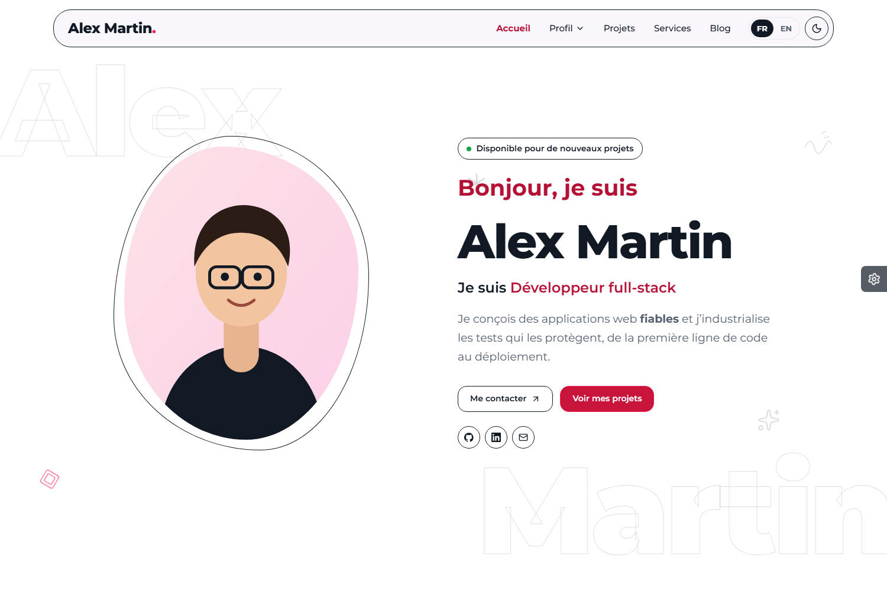

<div align="center">

# Hugo Portfolio Theme

**Thème Hugo bilingue pour portfolio, CV et blog.** CSS natif, JavaScript sans dépendance, SEO et accessibilité intégrés.

[](https://github.com/Aziguy/hugo-portfolio-theme/actions/workflows/ci.yml)


[](./LICENSE)

[**Voir la démo**](https://aziguy.github.io/hugo-portfolio-theme/) · [Configuration](./docs/CONFIGURATION.md) · [Contenu](./docs/CONTENU.md) · [Développement](./docs/DEVELOPPEMENT.md)



</div>

## Points forts

| | |
|---|---|
| **Sections à la carte** | L'accueil est une liste de sections déclarée dans la configuration : réordonnez, retirez ou ajoutez les vôtres. |
| **Multilingue natif** | Interface traduite (FR, EN), contenu par langue, sélecteur qui conserve la page, balises `hreflang`. |
| **Identité forte** | Cartes à contour dont l'image déborde, pastilles pastel à jauge circulaire, frise alternée à onglets, badges au texte tournant, lettres détourées, formes décoratives animées. |
| **Personnalisable par le visiteur** | Panneau d'outils : 10 couleurs d'accent, sens LTR / RTL, clair / sombre, mémorisés et appliqués sans flash. |
| **Projets filtrables** | Filtres par catégorie accessibles et pagination combinée, fiches projet avec client, rôle, période, technologies et résultats. |
| **Blog complet** | Pagination fenêtrée réglable, temps de lecture, sommaire, étiquettes, articles liés, flux RSS. |
| **CV** | Page en deux colonnes (photo, coordonnées, formation, compétences / expériences, projets) et PDF par langue. |
| **Moderne** | Typographie fluide, transitions de vue entre pages, `:has()`, propriétés logiques, mouvement réduit respecté. |
| **SEO** | Open Graph, URL canonique, JSON-LD (`Person`, `WebSite`, `BlogPosting`, `CreativeWork`), sitemap. |
| **Accessibilité** | Audit axe-core WCAG 2.1 AA sans violation en clair et en sombre, contraste vérifié pour les 10 couleurs, onglets et menus au clavier. |
| **Léger** | Aucun jQuery ni CDN : CSS concaténé et empreint, JS en modules ES compilé par Hugo, police woff2 auto-hébergée. |

## Démarrage rapide

Prérequis : [Hugo](https://gohugo.io/installation/) 0.146 ou plus récent (version standard suffisante).

### Essayer la démo

```bash
git clone https://github.com/Aziguy/hugo-portfolio-theme.git
cd hugo-portfolio-theme
hugo server --source exampleSite --themesDir ../..
```

### Utiliser le thème dans votre site

En module Hugo (recommandé) :

```bash
hugo mod init github.com/<vous>/<votre-site>
```

```toml
# hugo.toml
[module]
  [[module.imports]]
    path = "github.com/Aziguy/hugo-portfolio-theme"
```

Ou en sous-module Git :

```bash
git submodule add https://github.com/Aziguy/hugo-portfolio-theme.git themes/hugo-portfolio-theme
echo 'theme = "hugo-portfolio-theme"' >> hugo.toml
```

Copiez ensuite `exampleSite/hugo.toml`, `exampleSite/content` et `exampleSite/data` dans votre site comme point de départ.

## Structure

```
assets/
  css/            tokens, polices, base, mise en page, puis components/, sections/, pages/
  icons/          icônes SVG (Lucide), utilisables par leur nom
  js/             main.js + modules/ (thème, navigation, filtres, carrousel, apparitions)
i18n/             textes de l'interface (fr, en)
layouts/
  baseof.html     squelette commun
  home.html       rend les sections de params.home.sections
  _partials/
    head/         méta, SEO, JSON-LD, styles, scripts
    site/         en-tête, navigation, langue, thème, pied de page
    home/         une section d'accueil par fichier
    cards/        cartes projet, article, service
    ui/           icône, image responsive, frise, pagination...
    func/         fonctions : localisation, dates, URL d'image
  _markup/        rendu des liens, images et titres Markdown
  _shortcodes/    button, notice
  projects/ blog/ services/ about/ resume/
static/fonts/     Montserrat variable (woff2)
exampleSite/      site de démonstration bilingue
```

## Personnalisation en bref

```toml
[params]
  accent = "blue"            # rose, violet, indigo, orange, cyan, blue, red, pink, slate, green
  tools = false              # masque le panneau de personnalisation
  colorScheme = "system"     # system, light, dark
  [params.home]
    sections = ["hero", "about", "achievements", "projects", "contact"]
```

- **Styles** : créez `assets/css/custom.css` dans votre site, il est chargé en dernier.
- **Gabarits** : tout fichier de `layouts/` peut être surchargé à l'identique dans votre site.
- **Section d'accueil** : ajoutez `layouts/_partials/home/ma-section.html` et citez `ma-section` dans `sections`.
- **Icônes** : déposez un SVG dans `assets/icons/` et appelez-le par son nom.
- **Balises `<head>`** : ajoutez `layouts/_partials/head/custom.html` (analytics, vérification...).

Tous les détails : [docs/CONFIGURATION.md](./docs/CONFIGURATION.md) et [docs/DEVELOPPEMENT.md](./docs/DEVELOPPEMENT.md).

## Qualité

La CI construit la démo en mode strict (`--panicOnWarning`), vérifie tous les liens internes avec [lychee](https://lychee.cli.rs/) puis publie sur GitHub Pages. Les pull requests sont construites et vérifiées sans être publiées.

## Licence

[MIT](./LICENSE). Icônes [Lucide](https://lucide.dev) (ISC), police [Montserrat](https://github.com/JulietaUla/Montserrat) (SIL OFL 1.1).
